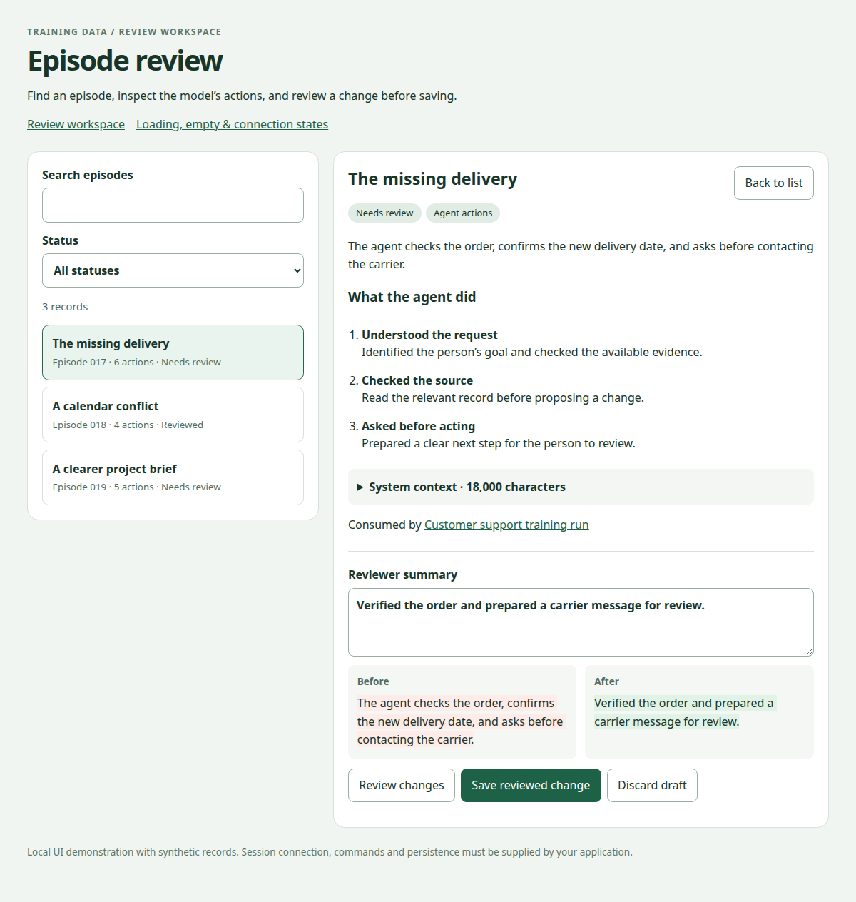
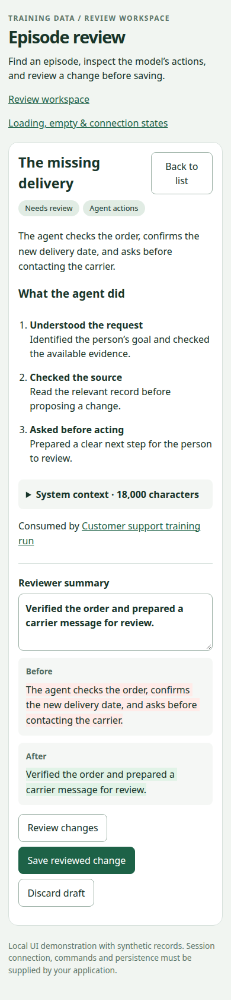
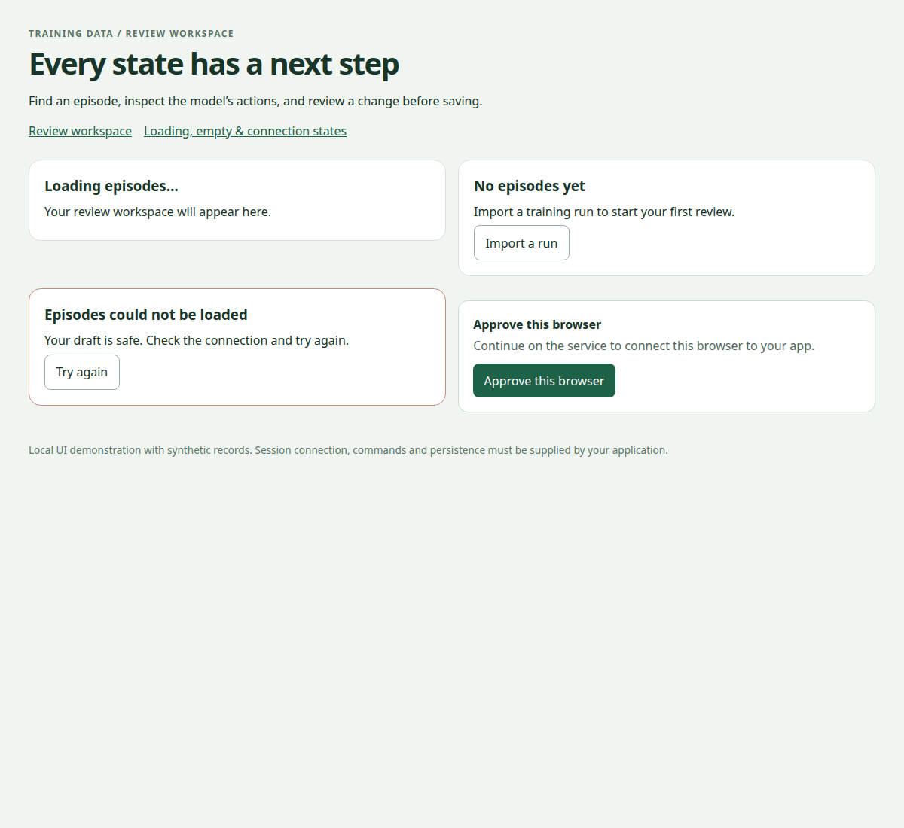

# Reuse the application helpers

Import the shared observer from the SDK. Adapt the other UI components from the
[first-app source archive](/downloads/tendriller-first-app.tgz) beside your authored `page.mjs`:

```js
import { createOwnerConnection, describeConnectionError } from './connection.mjs';
import { mountConnectionView } from './connect-view.mjs';
import { createLiveView } from '@chronolog/peer-session/browser';
import { createOperationView } from './helpers/operation-view.mjs';
import { createReviewedInput } from './helpers/reviewed-input.mjs';
```

`createLiveView` is a public SDK composition helper. The other modules are
executable application source supplied in the first-app archive. The
starter's `page.mjs` already uses the first two. Its `media/panel.mjs` composes
reviewed input with camera/file capture, an explicit inference request and a
declared evidence command. The [capability map](CAPABILITIES.md) points to the
other supplied modules.

Use the real native session or the browser facade returned by
`openBrowserOwner`. [Build an app](BUILD_AN_APP.md) supplies that complete
bootstrap, enrollment and publication path. These helpers observe and interact
with its existing session. They do not own its signer, database, transport,
recovery policy or process lifetime.

## Connect the browser

Every delivered page uses the connection component. **Do not ship the old
two-button flow** ("Request browser access" / "Connect existing device"), a
stepper, or raw error codes. Opening the page is the whole flow:

```js
const pairing = createBrowserPairing({ configuration, profileId, workerUrl: new URL('./pairing-worker.mjs', import.meta.url) });
const view = mountConnectionView(document.querySelector('#connection-slot'));
const connection = createOwnerConnection({ configuration, pairing, appName: 'Shared notes',
  // Attach (openBrowserOwner), start the app's views, and return once data is usable.
  // Throw the attach error unchanged: its code tells the component to set up, wait or retry.
  connect: connectSession,
  onState(state) { view.render(state); document.querySelector('#app').hidden = state.phase !== 'connected'; } });
void connection.start();
```

| Browser state | What the person sees | Action |
| --- | --- | --- |
| Enrolled (every later visit, any tab) | Nothing; the app opens | none |
| New browser, request being prepared | "Setting up this browser…" with progress | none |
| Prepared, agent program committing | "Finishing setup…" (the host approves the staged proposal automatically; the page never leaves) | none |
| Setup request expired (second time in a visit) | "Setup request expired" | **Request another review** |
| Another tab is starting the owner | "Connecting…" | none (retries) |
| Declined | "The request was declined" | **Ask again** |
| Signed out, private mode, other failures | Plain words from `describeConnectionError`; code under *Technical details* | **Reload** or **Try again** where useful |

While not connected, show only this card: no empty tables, "no data yet" or
stale-data warnings above it. Keep data views hidden until `phase` is
`connected`. Pass `onOwnerReplaced: reloadOnOwnerReplaced()` to
`openBrowserOwner`; the runtime binding installs once per page, so install it
only after `connect` has made the app usable.

### Match an application-owned palette

Set the connection card's color properties on its mount container or `:root`.
Inherited authored values survive the helper's stylesheet injection and later
state renders. For an app-selected dark palette even while the system prefers
light:

```css
#connection-slot {
  color-scheme: dark;
  --tc-bg: #171b2a;
  --tc-fg: #f3f4ff;
  --tc-muted: #b8bfd9;
  --tc-border: #596581;
  --tc-accent: #c4b5fd;
  --tc-accent-fg: #211942;
  --tc-accent-hover: #ddd6fe;
}
```

The roles cover the surface, title, muted text, borders, spinner/focus accent,
action text and action hover. Omit `--tc-accent-hover` to reuse an overridden
`--tc-accent` on hover. Without overrides the card retains its light and
system-dark defaults. The application owns theme choice: `color-scheme: dark`
alone does not activate a `prefers-color-scheme` media query. These hooks change
colors only; connection actions, accessibility and reduced motion are unchanged.

User-facing copy for the codes an app can meet (developer causes are in
[troubleshooting](TROUBLESHOOTING.md)):

| Code | Message |
| --- | --- |
| `APPLICATION_DEVICE_NOT_FOUND`, `DEVICE_NOT_ENROLLED` | Not an error: "Setting up this browser…", then "Finishing setup…" |
| `OWNER_BUSY`, `OWNER_UNREACHABLE`, `ENDPOINT_STALE` | "Connecting…" (another tab is starting); retried |
| `pairing_account_required`, 401 | "Sign in to continue" · Reload |
| `PAIRING_STORAGE_REQUIRED`, `PAIRING_LOCK_REQUIRED`, `QuotaExceededError` | "This browser can't keep the app's key" · use a normal tab |
| `pairing_rate_limited`, `pairing_ledger_full` | "Too many attempts"; retried |
| `denied` | "The request was declined" · Ask again |
| network and timeouts | "The connection is slow. Retrying…" |

Large live answers: a reply of several signals (each at most 16 KiB) can be sent
with the maintained `helpers/signal-request.mjs`, which reserves signed-frame overhead,
bounds replies and retries backpressure. The shared P2P-first transport carries
them directly where possible; the hosted relay is fallback only. Reassembly binds
the request recipient and computation generation, not just a bare request ID.

### Views that fit the data

A structured record editor (JSON or a plain form of fields) is a fallback, never
the deliverable for a "full-featured" or "rich" request. Build list/detail with
search and filter, an inspector side panel, diff/compare views, inline editing
with review and undo, timelines and conversations, tables with named links,
and explicit empty and loading states. Walk the flows on a phone-sized viewport
and desktop before delivery ([acceptance bar](AGENT_DELIVERY.md#the-user-experience-is-part-of-the-deliverable)).

## Full-duplex dashboards and data feeds

For dashboards where an agent runs on a cloud server or home server and the user
opens the page on a phone, tablet or laptop, compose `ui/dashboard.mjs`,
`helpers/data-feed.mjs`, `ui/chat-session.mjs`, and `helpers/dev-telemetry.mjs`:

```js
// Native agent process (secrets & local API access stay strictly native):
import { serveDataFeeds } from './helpers/data-feed.mjs';
const feeds = serveDataFeeds(session, {
  cpu: { pollMs: 5_000, fetch: async () => readHostMetrics() },
  orders: { maxAgeMs: 10_000, fetch: async (query) => fetchPrivateApi(query) },
});

// Browser page:
import { useDataFeed } from './helpers/data-feed.mjs';
import { mountDashboardShell, mountMetricCard, mountFeedbackCard } from './ui/dashboard.mjs';
import { mountDevTelemetry } from './helpers/dev-telemetry.mjs';

const shell = mountDashboardShell(document.querySelector('#app'), {
  title: 'Home Server', session,
  onRefresh: () => cpuFeed.refresh(),
});
const cpuCard = mountMetricCard(shell.grid, {
  title: 'CPU Load', unit: '%',
  onAskAgent: ({ title, latest }) => { chat.setContext({ label: title, data: latest }); chat.open(); },
});
const cpuFeed = useDataFeed(session, {
  peer: configuration.nativeDeviceId, feed: 'cpu',
  onUpdate: state => state.data && cpuCard.update({ value: state.data.pct, fetchedAtMs: state.fetchedAtMs }),
});
const telemetry = mountDevTelemetry({ session, runtime: window.tendril });
```

`serveDataFeeds` polls only while a peer is connected, skips unchanged snapshots,
caches in RAM, broadcasts deltas over `session.signals` (`feed/<name>`), and serves
on-demand or large (>10 KiB, up to 4 MiB) pulls via `helpers/signal-request.mjs`—all
with **zero durable Chronolog writes**. Reserve Chronolog commands for durable user
decisions, chat turns, and retained observations.

## Domain views you can import

The first-app archive includes `ui/patterns.mjs` and a complete, dependency-free
`ui/showcase.html` / `ui/showcase.mjs` example. Serve the extracted starter over
local HTTP and open `/ui/showcase.html`; it uses synthetic training episodes to
show useful actions before long system context, named related links and reviewed
inline changes. It is a UI specimen, not a connected or persistent application.

```js
import {
  mountListDetail, mountInspector, mountComparison, mountInlineReview, mountViewState,
} from './ui/patterns.mjs';
```

| Pattern | Interface | Behavior and application responsibility |
| --- | --- | --- |
| Searchable list/detail | `mountListDetail(container, { records, filters, renderDetail, routeKey?, searchLabel? })` | Records contain `id`, `title`, optional `subtitle`, `status` and `searchText`. Filters are `[value, label]` pairs. Search, filter and selected record are URL-addressable; Back and reload restore them. `setRecords(records)` accepts the next coherent query value; `close()` disposes listeners and the active detail. Filtering is over that authorized value, not a second backend query. |
| Inspector | `mountInspector(container, { onClose })` | `show(title, { focus })`, `content`, `hide()` and `close()` support a desktop side panel and narrow detail view. The list/detail composition provides Back to list and restores focus. A standalone inspector supplies its own navigation callback. |
| Compare | `mountComparison(container, { before, after, label? })` | Readable before/after text with explicit headings. Authored values are inserted as text. `close()` removes it. Adapt the presentation for domain fields or line-level code diffs. |
| Inline edit, review and undo | `mountInlineReview(container, { label, value, onSave, onUndo? })` | Keeps an editable draft, previews exact before/after values, saves only reviewed text and offers undo only with an injected callback. The callbacks receive `{ before, after }`; confirm an accepted applied result before returning `{ confirmed: true, value }`. `observe(value)` handles live values without resolving operations. Failure or uncertainty locks the editor until explicit `reconcile(confirmedValue)`; it does not resubmit or pretend a failed write was cancelled. `close()` stops rendering, not a dispatched command. |
| Empty/loading/error | `mountViewState(container)` then `render({ phase, title, detail?, action? })` | `loading` exposes busy status, `error` exposes an alert, `empty` explains the next action, and `ready` hides the card. An optional action is `{ label, run }`; wire it to a real operation. `close()` removes the view. |
| Connection | `mountConnectionView(container)` from `connect-view.mjs` | Use the real `createOwnerConnection` state and action. The specimen renders the same component; [the complete connection route](#connect-the-browser) stays authoritative. |

`renderDetail(record, container)` can return **`{ update(record), close() }`**.
The detail stays mounted while the selected ID is unchanged; fresh coherent
snapshots call `update`, including when their objects have new identities.
Selection changes, record removal and `close()` dispose that detail once. A
renderer returning only a cleanup function (or nothing) still remounts for a
replacement object so a static detail cannot silently show stale data.

A stateful detail updates its display and observes its edited value separately:

```js
function renderSummaryDetail(record, container) {
  const summary = document.createElement('p');
  summary.textContent = record.summary; container.append(summary);
  const editor = mountInlineReview(container, {
    label: 'Summary', value: record.summary,
    // Application handlers capture guards/revision and the original operation ID.
    onSave: change => saveSummary(record.id, change),
    onUndo: change => saveSummary(record.id, change),
  });
  return {
    update(next) {
      record = next;
      summary.textContent = next.summary;
      editor.observe(next.summary);
    },
    close() { editor.close(); },
  };
}
// Pass renderDetail: renderSummaryDetail when mounting the list/detail.
```

`observe(value)` accepts the edited field from the same coherent live view.
Unchanged values preserve draft, confirmation and Undo. A changed value refreshes
a pristine editor; with a draft or saved Undo it keeps that local work, disables
stale Save/Undo, and asks for an explicit review against the latest value or
Discard draft. A background refresh never steals focus or dispatches a command.
The application's command must still guard the exact reviewed baseline.

During a save, observation records the latest value without settling the pending
operation. A matching snapshot can arrive before or after its accepted callback.
A differing concurrent value remains visible as a conflict. A failed or uncertain
callback stays locked even when a later snapshot matches the draft: inspect the
original operation, then deliberately call `reconcile(confirmedValue)`. That
method clears draft/review/Undo; it is not a live-refresh method.

Keep retained drafts and uncertain operation references in the app's existing
draft/submission controller when navigation closes a detail. Closing a renderer
does not cancel a dispatched command. Give independent list/detail instances
distinct `routeKey` values; the helper preserves unrelated URL parameters.

### Compose a map or another companion view

These helpers are application-owned source, not a general component framework.
For a map/list application, adapt the existing `mountListDetail` render path:
compute `route` and filtered `visible` records once, then pass those same values
to the companion. For example, add this call after the existing list rendering:

```js
// paintMap is this application's view adapter, not a Tendriller API.
paintMap(visible, {
  selectedId: route.id,
  onSelect: id => navigate({ item: id }, false, true),
});
```

Keep `locationState()` and `navigate()` as that adapted helper's single route
owner. Its initial render, search/filter changes, `popstate` and `setRecords()`
then update both views without reading private DOM nodes, another backend query
or a second synchronized selection store. The companion must not change route
state while merely rendering it. An application with its own list/router can
instead compose the lower-level `mountInspector`. The shared helper does not
need map-specific options, a state subscription API or another router.

A connected app feeds one declared query through `createLiveView`, adapts those
records for the list, and injects existing command handlers into the editor. Capture
the coherent revision and original operation ID before dispatch. Save and undo
must both use guarded domain commands; an undo is new reviewed work, not deletion
of a journal event. Use the operation/submission helpers below for uncertainty and
recovery. Application content never becomes `innerHTML` in these components.

### Desktop: search, inspector and reviewed comparison



### Phone: a focused detail with a route back



### Empty, loading, error and connection states



These are real Chromium captures of the supplied specimen, at 1200×1100 and
390×844 viewports. Reproduce the behavior check with
`node --test scripts/test/browser/ui-patterns.test.mjs` in the source repository;
set `UPDATE_PATTERN_SCREENSHOTS=1` to refresh the images after reviewing a change.
The check covers fresh contexts, search/filter, named links, deep links, Back,
reload, keyboard focus, immutable-snapshot/save ordering, concurrent edited values,
review/save/undo, uncertainty locking, long phone headings and narrow overflow.
It does not establish live pairing, replication or physical-phone behavior.

## Durable agent requests and listener status

For work a native agent must consume, use the executable
[request, receipt, answer and heartbeat pattern](AGENT_REQUESTS.md). It retains
full operation references, author timestamps and last-seen consumer records for
late-joining pages. Show saved/applied journal state separately from seen/answered
work, and keep stale listener status visible on the request. An attached peer is
not evidence of a running consumer. After a release or owner replacement, follow
the [consumer restart checklist](AGENT_RESTART.md).

## 1. A coherent live query

This function mounts the first-app `notes` query into its existing HTML elements.
Call it after opening the session. When adapting `page.mjs`, replace the
corresponding existing rendering block instead of installing duplicate observers.

```js
import { createOwnerConnection, describeConnectionError } from './connection.mjs';
import { mountConnectionView } from './connect-view.mjs';
import { createLiveView } from '@chronolog/peer-session/browser';

export function mountNotes(session, root = document) {
  const list = root.querySelector('#notes');
  const status = root.querySelector('#data-status');
  const recovery = root.querySelector('#recovery');
  const error = root.querySelector('#result');
  const refreshButton = root.querySelector('#refresh');
  const report = failure => { error.textContent = failure.message; };

  const view = createLiveView(session, {
    query: 'notes', input: null,
    onStatus(value) {
      status.textContent = `Application: ${value.phase}; data: ${value.database}`;
    },
    onRecovery(notice) {
      recovery.hidden = false;
      recovery.textContent = `Selected history changed. Excluded known operations: ${notice.abandoned.length}; unknown loss: ${notice.unknownLoss}`;
    },
    onError: report,
  });
  const unsubscribe = view.subscribe(({ value }) => {
    list.replaceChildren(...value.map(note => {
      const item = document.createElement('li');
      item.textContent = `${note.text} — ${note.author.slice(0, 12)}`;
      return item;
    }));
  });
  const refresh = () => { void view.refresh().catch(report); };
  refreshButton.addEventListener('click', refresh);

  return {
    view,
    close() {
      refreshButton.removeEventListener('click', refresh);
      unsubscribe();
      view.close();
    },
  };
}
```

`createLiveView` subscribes to real session changes and recovery, starts an
initial query, and coalesces invalidations. It serializes its reads and ignores
a result superseded by a later invalidation. It does not compare revision
numbers to guess which generation wins. Every delivered snapshot is one
`{ revision, value }` from the declared query's coherent view.

| Surface | Contract |
| --- | --- |
| `createLiveView(session, { query, input, onSnapshot?, onStatus?, onRecovery?, onError?, signal? })` | Captures the query input once and observes the existing session |
| `view.subscribe(listener)` | Receives coherent snapshots; immediately receives the last snapshot when available; returns an unsubscribe function |
| `await view.ready({ signal?, timeoutMs? })` | Waits for the first coherent read within a fixed 30-second default deadline; `PEER_RECOVERING` waits for readiness/change events on the same session, while fatal errors reject |
| `await view.refresh()` | Requests a fresh coherent snapshot; overlapping requests can resolve from the same latest read |
| `view.snapshot` | Last successful snapshot, or `null` before one arrives |
| `view.status`, `view.error` | Separate session status and last read/observation error |
| `view.close()` | Stops this observer and rejects its outstanding refresh waiters; does not close the session |

While `ready()` is waiting, expected initial `PEER_RECOVERING` is retained in
`view.error` without calling `onError`. Fatal errors and explicit refresh failures
still call `onError`.

Treat snapshot values as read-only. Keep the revision with its value when
preparing a command. To change a query filter, close the old view and construct
a new one with the new input. Do not merge independently queried values and
label the result a single coherent snapshot; define one domain query that reads
the related values together.

`session.changes()` is a stream of invalidations, not an event replay log.
Retained events belong in a declared query or an explicit history consumer.
The [native event-consumer example](AGENT_RESTART.md#native-event-reads-and-captured-view-lifetime)
connects invalidation, captured event reads, `finally` release and durable handled
checkpoints to the canonical recovery-review procedure.
Connection progress is also separate: observe `session.participation.onStatus`
for peer connectivity. A backend being installed is not proof that keys,
materialization or peers are ready.

Closing this helper ignores late reads because `session.query` has no per-query
cancellation argument. The component that owns the application must still close
the session, RTC bridge and Worker when its lifetime ends. See
[the owned-session contract](APPLICATION_BACKENDS.md).

## 2. An operation's actual state and separate retention evidence

Observe the journal with its original operation identity. The optional
`operation` parameter is the actual handle returned by `session.command` or
`session.reapply`:

```js
import { createOperationView } from './helpers/operation-view.mjs';

export function watchOperation(session, operationId, output, operation) {
  const view = createOperationView(session, {
    operationId, operation,
    onChange({ state, coverage, waitingForShared, recovery }) {
      output.textContent = JSON.stringify({
        operationId,
        state,
        observedRetentionReceipts: coverage?.length ?? null,
        waitingForShared,
        recovery,
      }, null, 2);
    },
    onError(error) {
      output.textContent = `${operationId}: observation unavailable (${error.message}); inspect the original operation.`;
    },
  });
  return view;
}
```

An ID-only view is useful after reload. It can inspect the saved attempt and its
current state without inventing another command. The helper's state is the
actual `inspection.state` returned by `session.operations.inspect`, including
its accepted/rejected outcome and rejection code where applicable.

| Observation | What the UI should say |
| --- | --- |
| `state === null` | No saved attempt is visible here; keep the original input and identity while resolving the initial call |
| `state.status === 'saved'` | The attempt is saved on this device; applied execution has not been observed |
| `state.status === 'applied'`, `outcome === 'accepted'` | The operation was accepted in the reported selected history |
| `state.status === 'applied'`, `outcome === 'rejected'` | Execution rejected the program; show the rejection code and current state |
| `abandoned` or `needsReapply` | Inspect recovery and the current application view before offering deliberate reapplication |
| `coverage !== null` | Peer retention receipts were observed for that attempt; this is a separate observation |

There is no synthesized `shared` journal status. If you have the original
operation handle, request retention observation separately:

```js
const coverage = await operationView.waitForShared({
  signal: AbortSignal.timeout(15_000),
});
```

`waitForShared` uses that handle's `shared()` method. It does not publish another
command or interpret an elapsed timeout as lost data. An ID-only reopened helper
deliberately reports coverage as unknown; it rejects `waitForShared` instead of
fabricating a receipt. Previously observed retention evidence can remain visible
after recovery. It does not prevent that recovery from excluding the operation.

`operationView.refresh()` returns its latest inspection snapshot.
`operationView.retry()` retries a visible saved attempt under the same identity;
it refuses an absent attempt or one requiring reviewed reapplication.
`operationView.close()` stops observation, not the command or session. Aborting
an applied/shared waiter also cancels only the waiter.

## 3. Preserve uncertain intent before the first dispatch

### Keep every action control reactive

Use `createSubmissionState(onChange)` for every write control, including cards
and a persistent detail editor. Eligibility changes when an operation finishes
even if no new data snapshot arrives. Keep record rendering subscribed to the
live view and eligibility subscribed to submission state. Adapt the starter's
existing submission instance and callback with this small multi-control pattern;
do not add a second coordinator alongside it:

```js
// submission-controls-example
import { createSubmissionState } from './helpers/submission-state.mjs';

export function createWriteControls(root) {
  const eligibility = { submit: 'canSubmit', retry: 'canRetry', reapply: 'canReapply' };
  function render(state) {
    for (const button of root.querySelectorAll('[data-write-action]')) {
      button.disabled = !state[eligibility[button.dataset.writeAction]]
        || button.dataset.domainBlocked === 'true';
      button.setAttribute('aria-busy', String(state.working));
    }
    const status = root.querySelector('[data-submission-status]');
    if (status) status.textContent = state.message;
  }
  const submission = createSubmissionState(render);
  const sync = () => render(submission.snapshot);
  sync();
  return { submission, sync };
}
```

For example, both a card's **Save** and the detail editor's **Save** use
`data-write-action="submit"`; retained-operation buttons use `retry` or `reapply`.
Keep a domain-invalid or unauthorized control blocked with
`data-domain-blocked="true"`, and preserve domain checks in its handler too.
After inserting a new card or changing its domain eligibility, call `sync()` to
initialize it from the current snapshot. The callback only updates disabled/busy
state and status text; it does not replace cards, inputs, focus or selection. Use
the [preserved editor lifecycle](#domain-views-you-can-import) for data renders.

Keep the starter's existing `application`, `participation`, `read`, pending and
operation-observer updates wired to this same `submission` instance. A live-view
read error or recovery must invalidate `coherent`; a later successful current
read restores it. Continue to acquire `release = submission.begin()` inside the
handler's `try`, retain the signed-operation reference, await its applied result,
and finish the coherent refresh before calling `release?.()` exactly once in
`finally`. That final callback re-enables all eligible controls without another
query or data notification. An uncertain pending operation, failed refresh,
disconnection or recovery keeps them blocked even after `working` is released.

Do not move release ahead of refresh to force a data render. The current release
closure is not an operation token: an early call followed by a second call in
`finally` can clear another submission's working state. On errors preserve the
appropriate original operation and recovery state; finishing this UI lifecycle
does not cancel, retry or declare the command accepted.

### Retain the original operation reference

Chronolog owns the signed attempt and its delivery. The UI still needs enough
local information to identify a first call whose reply was lost before the
page received its handle. Save one pending reference **before** calling
`session.command`: the command name, exact input, operation ID and captured
revision. The starter also keeps the original identity when explicitly
reapplying. This reference is not another delivery queue.

Here is a small executable submission function for the existing `addNote`
command. It refuses another submission while the prior reference is unresolved:

```js
const pendingKey = session =>
  `app:${session.applicationId}:device:${session.deviceId}:pending`;

export async function submitNote(session, liveView, text, storage = localStorage) {
  const key = pendingKey(session);
  if (storage.getItem(key)) throw Error('Inspect or retry the unresolved operation first.');
  const observed = await liveView.refresh();
  // Another user action may have completed while the view was loading.
  if (storage.getItem(key)) throw Error('Another operation is already unresolved.');
  const record = {
    id: crypto.randomUUID(), command: 'addNote', input: { text: text.trim() },
    basedOn: observed.revision,
  };
  if (!record.input.text || record.input.text.length > 2000) {
    throw Error('Write a note of 1–2000 characters first.');
  }
  storage.setItem(key, JSON.stringify(record)); // A failed write prevents dispatch.
  const operation = await session.command(record.command, record.input, {
    operationId: record.id, basedOn: record.basedOn,
  });
  return { record, operation };
}
```

After a successful return, attach an operation view and await `operation.applied`
with a bounded waiter. If either call fails or times out, retain the reference.
Only an observed accepted/rejected outcome or a deliberate recovery decision can resolve
it. The supplied page clears its active pending reference after observing an
`applied` result and displays accepted versus rejected separately.

An explicit **Retry original** action must also handle the case where the first
call never became visible in the journal:

```js
export async function retryOriginal(session, record) {
  const current = await session.operations.get(record.id);
  if (['abandoned', 'needsReapply'].includes(current?.status)) {
    throw Error('Review the current state and original attempt before reapplying.');
  }
  if (current) {
    await session.retry(record.id);
  } else {
    const options = { operationId: record.id, basedOn: record.basedOn };
    if (record.reapplies) {
      await session.reapply(record.reapplies, record.command, record.input, options);
    } else {
      await session.command(record.command, record.input, options);
    }
  }
  return session.operations.wait(record.id, { signal: AbortSignal.timeout(15_000) });
}
```

The record must belong to this application and existing device. Do not create a
new signer to resolve an old pending action. Never replace the saved input or
`basedOn` revision during a retry. An edited request is new work and needs a
separate decision after the uncertain original is resolved.

Reapplication is different: after showing the current coherent state, ask the
person to review the domain values and guards. Save a new pending reference
containing `reapplies: originalId`, then call:

```js
const operation = await originalOperationView.reapply({
  name: reviewedRecord.command,
  input: reviewedRecord.input,
  operationId: reviewedRecord.id,
  basedOn: reviewedRecord.basedOn,
});
```

The helper verifies that the original is currently `abandoned` or `needsReapply`;
it does not make the domain review or authorization decision. It never chooses
a new ID. For SQL, retain the actual row preconditions in the new program as
well as the coherent revision; see [guarded transactions](STATE_MODELS.md).

## 4. Capture, analyze, edit, then commit once

Use `createReviewedInput` to keep asynchronous evidence work attached to the
candidate and task the person actually selected. The supplied
`media/panel.mjs` is the complete page integration; [Reviewed AI input](AI_INPUT.md)
provides camera/file, inference peer and provider setup. Its imports include:

```js
import { createReviewedInput } from './helpers/reviewed-input.mjs';
import { createPeerInferenceClient } from './media/inference-client.mjs';

const inference = createPeerInferenceClient({
  session,
  workerDeviceId: configuration.nativeDeviceId,
  prompt: 'Describe the visible evidence as editable notes. State uncertainty.',
});
```

`configuration.nativeDeviceId` identifies the intended enrolled native peer; it
is a public key, not a credential. The native service must be explicitly enabled
for this browser with its own request budget and chosen provider. Provider keys
stay in that process. Calling an analyzer is an explicit external-data and cost
decision; importing the modules does not make that decision.

Inside the supplied panel, the page injects `prepareEvidence` as `prepareCommit`
and `submitEvidence` as `commit`. Preparation stages any missing content,
validates the values and persists the complete pending reference before the panel
calls `review.commit`. A preparation failure leaves the candidate available for
review; it has dispatched no command. The commit callback dispatches only the
matching prepared intent. The controller composition is ordinary JavaScript:

```js
const review = createReviewedInput({
  analyze: input => inference.analyze(input),
  commit, // Injected page.mjs submitEvidence callback, not another backend.
  onChange(snapshot) {
    container.querySelector('#media-status').textContent = snapshot.phase;
  },
});
```

The generic controller's exact interfaces are:

| Call | Result and boundary |
| --- | --- |
| `createReviewedInput({ analyze, commit, onChange?, signal?, maxBytes? })` | Creates a page-local controller; default evidence bound is 8 MiB |
| `await review.capture({ blob, context, signal? })` | Copies a nonempty immutable Blob, hashes it and captures plain-JSON context; returns a candidate with `id`, `blob`, `sha256`, `type`, `size`, `context` |
| `await review.analyze({ signal? })` | Calls `analyze({ candidate, signal })`; stores a plain-JSON suggestion without overwriting reviewed edits |
| `review.edit(value)` | Captures the explicitly reviewed plain-JSON values; invalidates in-flight analysis |
| `await review.commit({ operationId, signal? })` | Calls the supplied `commit({ candidate, reviewed, operationId, signal })` once; requires prior explicit edit/review |
| `review.cancel()` | Before dispatch, cancels pending work and discards the local candidate/review |
| `review.close()` | Ends this controller; late work cannot update it |

Capture the application context before starting asynchronous work. The starter
uses the revision attached to its displayed notes view. A mutable task UI should
also capture the intended task ID and relevant row values; completing analysis
must not reread whichever task is selected later. The generic helper preserves
context but does not enforce domain invariants. Use the SQL command's guards
when a task, balance or reservation can change during review.

The inference adapter returns `{ suggestion, source }`, where `source` binds the
candidate ID, SHA-256 and a real session `ContentReference`. Keep that source
association when editing the suggested text. The supplied page's durable commit
uses the settled command shape:

```js
const input = {
  text: reviewed.text,
  source: reviewed.source,
  capturedRevision: JSON.stringify(candidate.context.revision),
};
// Persist this complete input, operationId and basedOn in the app's pending
// reference before dispatch; media/panel.mjs and page.mjs provide that path.
const operation = await session.command('addEvidence', input, {
  operationId,
  basedOn: candidate.context.revision,
});
const outcome = await operation.applied({ signal });
```

The source has `{ candidateId, sha256, reference }`. It must still identify the
captured candidate and the analyzed content. The person's editable text is
separate from those source bindings. `addEvidence` emits a retained note with
the reviewed source; an inference reply does not invoke that command by itself.

For manual review without Analyze, preparation stages the captured Blob on the
person's explicit Save action and constructs the source itself, before
`review.commit`. A provider request is optional; the same reviewed command and
journal still apply. The panel holds the reviewed text read-only during
preparation and after dispatch so it cannot diverge from the prepared intent.

The helper's phases describe its UI workflow. `submitted` means its commit
callback returned a plain-JSON result; the callback and the real journal establish
whether the command is saved or applied. The supplied callback awaits the
actual applied outcome.

After a commit is dispatched, this controller is permanently a **single
submission controller**. It rejects retake, edit, cancel and a second commit,
and provides no implicit retry/reapply. A rejected Promise or aborted response wait leaves the operation ID
visible as `uncertain`; it cannot establish that no command was saved. Resolve
that identity through the real operation journal and the pending-reference flow
above. A deliberate new capture uses a new controller only after the application
has resolved or explicitly separated the previous work.

The controller does not persist a Blob, restore its candidate after reload,
retain content on peers, or save the application's pending reference. Those are
application-owned decisions. The supplied inference callback stages immutable
content for the actual analysis request; content staging and provider completion
still do not establish command acceptance or retained peer coverage. If reload
resume is required, preserve the appropriate content reference and reviewed
input explicitly. Do not serialize a live stream, provider key or signing key
into page storage.

On component teardown, close the review controller and inference client, release
camera/voice resources, and then let the application owner close its session.
The full source demonstrates that cleanup. For the distinction between layout
and a connected preview of these behaviors, use [Preview](tools/PREVIEW.md).
